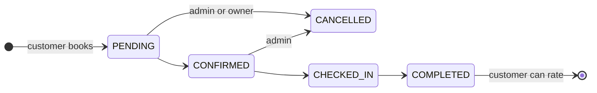
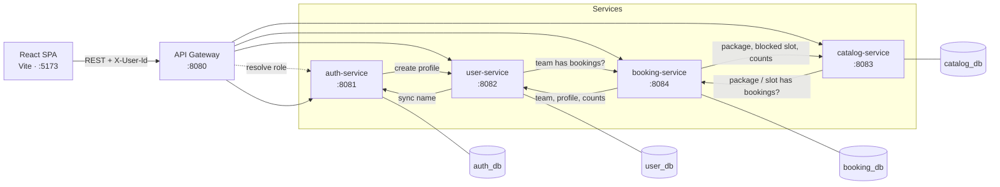

# Sports Arena Booking System

A full-stack booking platform for sports facilities, built as **five Spring Boot microservices** behind a Spring Cloud Gateway, with a **React + TypeScript** client.

Customers register, manage their teams, browse arena packages and book hourly slots. Administrators run the catalog, block slots for maintenance, move bookings through a fixed lifecycle and review ratings and reports.


---

## Contents

- [Highlights](#highlights)
- [Features](#features)
- [Architecture](#architecture)
- [Tech Stack](#tech-stack)
- [Project Structure](#project-structure)
- [Getting Started](#getting-started)
- [API Overview](#api-overview)
- [Testing](#testing)
- [Design Notes and Limitations](#design-notes-and-limitations)

---

## Highlights

- **Database per service.** Auth, user, catalog and booking data live in four separate MySQL schemas. Services share data only over REST, never through cross-schema queries.
- **The gateway decides the role.** A global filter ([RoleResolutionGlobalFilter.java](backend/gateway-service/src/main/java/com/infy/sportsarena/gateway/filter/RoleResolutionGlobalFilter.java)) ignores the client's `X-User-Role` header. It looks up the real role from `auth-service` and rewrites the header before forwarding, so editing `localStorage` cannot grant admin rights.
- **Fallbacks chosen per call.** Each inter-service call uses a Resilience4j circuit breaker, and each fallback is chosen for its risk:
  - Team and package deletion **fail closed**: if `booking-service` is down, the record is treated as having active bookings and is kept.
  - The blocked-slot check **fails open**, so a catalog outage does not stop customers from booking.
- **Explicit booking state machine.** Status changes are checked against a transition map in [BookingService.java](backend/booking-service/src/main/java/com/infy/sportsarena/booking/service/BookingService.java). Invalid jumps such as `PENDING → COMPLETED` are rejected.
- **Slot conflicts checked across services.** A booking is refused if the package is inactive, the slot is blocked in `catalog-service`, or the slot is already held. An admin cannot block a slot that holds a live booking.
- **Profile creation repairs itself.** If `user-service` is down at registration, the profile is created on the user's next login.

## Features

| Area | Customer | Administrator |
|---|---|---|
| **Account** | Register, log in, edit profile (name, contact, address). The profile name is synced back to `auth-service`. | Log in; view and search all customer profiles |
| **Teams** | Create, edit and delete own teams (5 sport types, unique names). A team with active bookings cannot be deleted. | Read-only view of all teams |
| **Catalog** | Browse **active** packages by category; search, sort and paginate | Full CRUD on categories and packages; activate or deactivate packages |
| **Slots** | Booked and blocked slots are disabled in the booking form | Block or unblock a slot per package and date, with a reason |
| **Bookings** | Book a slot for an owned team; get an `ARN-…` reference number; cancel while `PENDING` | Search by reference or customer, filter by status and date, advance status |
| **Ratings** | Rate a `COMPLETED` booking once (1–5 stars, optional review) | Average rating per package and each individual review |
| **Dashboard** | Own teams, total, active and completed bookings | Counts of customers, categories, packages and bookings, bookings by status, recent activity |

**Booking lifecycle**



> Admins move a booking through the transition map. A customer can cancel only while the booking is `PENDING`.

## Architecture



| Service | Port | Database | Owns | Gateway routes |
|---|---|---|---|---|
| `gateway-service` | 8080 | — | Routing, CORS, role resolution | entry point |
| `auth-service` | 8081 | `auth_db` | Credentials, roles, user ID generation | `/api/auth/**` |
| `user-service` | 8082 | `user_db` | Customer profiles, teams | `/api/users/**`, `/api/teams/**` |
| `catalog-service` | 8083 | `catalog_db` | Categories, packages, slot blocks | `/api/categories/**`, `/api/arena-packages/**`, `/api/slots/**` |
| `booking-service` | 8084 | `booking_db` | Bookings, ratings, dashboard aggregation | `/api/bookings/**`, `/api/ratings/**` |

**How requests flow**

1. The React client sends every request to the gateway. The Axios base URL is `http://localhost:8080` in [axios.ts](frontend/src/api/axios.ts).
2. The gateway resolves the caller's role, then routes by path prefix.
3. Services call each other through a `@LoadBalanced` `RestTemplate` using logical names such as `http://booking-service/...`.
4. Service discovery uses Spring Cloud's **simple discovery client**: static `localhost` URIs in each `application.properties`. The Consul starter is on the classpath but turned off (`spring.cloud.consul.enabled=false`), so **no Consul agent is needed** to run locally.

## Tech Stack

| Layer | Technologies |
|---|---|
| **Backend** | Java 21, Spring Boot 3.2.4, Spring Web, Spring Data JPA (Hibernate), Bean Validation, Lombok, ModelMapper 3.1.1 |
| **Microservices** | Spring Cloud Gateway (2023.0.1), Spring Cloud LoadBalancer, Resilience4j circuit breaker, Spring Boot Actuator, springdoc-openapi 2.5.0 |
| **Database** | MySQL; one schema per service; `ddl-auto=update` plus SQL seed scripts |
| **Frontend** | React 18, TypeScript 5, Vite 5, React Router 6, Axios, Bootstrap 5 and Bootstrap Icons (CDN) |
| **Testing and quality** | JUnit 5, Mockito, AssertJ, JaCoCo (coverage gate), Jest 29, React Testing Library, SonarQube config |

## Project Structure

```text
.
├── backend/
│   ├── pom.xml                         # Parent POM: Boot 3.2.4, Spring Cloud BOM, JaCoCo, Sonar
│   ├── seed-all.sql                    # Runs all four seed scripts in one go
│   ├── backfill-customer-profiles.sql  # One-off repair: auth users missing a profile
│   ├── gateway-service/                # Routes, CORS, RoleResolutionGlobalFilter
│   ├── auth-service/                   # Register, login, role lookup
│   ├── user-service/                   # Customer profiles and teams
│   ├── catalog-service/                # Categories, packages, slot availability
│   └── booking-service/                # Bookings, ratings, dashboard
│       └── src/main/java/com/infy/sportsarena/booking/
│           ├── controller/  service/  repository/
│           ├── entity/      dto/      config/   exception/
│           └── BookingServiceApplication.java
│       (each service also has src/main/resources/application.properties + tablescript.sql)
└── frontend/
    ├── src/
    │   ├── api/          # Axios instance (headers, 401 handling) and typed API clients
    │   ├── context/      # AuthContext: session in localStorage, cross-tab logout
    │   ├── components/   # Header, Sidebar, Footer, ProtectedRoute (role-gated routes)
    │   ├── pages/        # 13 screens: Dashboard, Teams, ArenaBrowse, BookingForm, Slots, Reports, …
    │   └── types.ts      # Shared DTO types and the TIME_SLOTS list
    ├── jest.config.cjs
    └── vite.config.ts
```

Every backend service uses the same layered packages: `controller → service → repository`, with entities kept behind DTOs, ModelMapper doing the conversion, and one `@ControllerAdvice` exception handler per service.

## Getting Started

### Prerequisites

| Tool | Version | Notes |
|---|---|---|
| JDK | **21** | Use 21 exactly. On a newer JDK, the Lombok version managed by Boot 3.2.4 fails to compile. |
| Maven | 3.9+ | |
| MySQL | 8.x recommended, on `localhost:3306` | The services create their schemas on first start (`createDatabaseIfNotExist=true`). |
| Node.js / npm | 18+ | For the Vite dev server and Jest |

Ports **8080–8084** and **5173** must be free.

### 1. Configure the database connection

Each service reads its MySQL settings from its own `src/main/resources/application.properties`. Don't commit real credentials. Override them with environment variables, which take precedence through Spring Boot's relaxed binding:

```bash
export SPRING_DATASOURCE_USERNAME=root
export SPRING_DATASOURCE_PASSWORD='<your-mysql-password>'
```

Set these in every terminal you use to start a service.

### 2. Load the demo data (optional, recommended)

The tables are created automatically on startup. To add sample categories, packages, teams and bookings, run this from the **repository root**. The script uses relative `SOURCE` paths, so the working directory matters.

```bash
mysql -u root -p < backend/seed-all.sql
```

This creates one admin account (`A1`) and four customer accounts (`U1`–`U4`). Their logins are in [auth-service/…/tablescript.sql](backend/auth-service/src/main/resources/tablescript.sql). New sign-ups receive the next ID (`U5`, `U6`, …).

### 3. Start the backend

Build once, then start each service in its own terminal:

```bash
cd backend
mvn clean install -DskipTests

# one terminal per service
mvn -pl auth-service    spring-boot:run   # :8081
mvn -pl user-service    spring-boot:run   # :8082
mvn -pl catalog-service spring-boot:run   # :8083
mvn -pl booking-service spring-boot:run   # :8084
mvn -pl gateway-service spring-boot:run   # :8080
```

Start order doesn't matter, but the gateway can't resolve roles until `auth-service` is up. Health checks are at `http://localhost:<port>/actuator/health`. The four business services also serve Swagger UI at `http://localhost:<port>/swagger-ui.html`. The gateway does not proxy Swagger.

### 4. Start the frontend

```bash
cd frontend
npm install
npm run dev
```

Vite serves the app at **http://localhost:5173** and opens it in your browser. If 5173 is taken, Vite picks the next free port; the gateway's CORS rules accept any origin.

<details>
<summary><b>Ports already in use?</b></summary>

The gateway must stay on **8080**, because the frontend calls `http://localhost:8080`. The other services can move. Every service needs the new addresses so the services can still find each other, so pass the same overrides to all five, plus the new `--server.port` for each moved service. For example, to move auth-service to 9081:

```bash
java -jar auth-service/target/auth-service-0.0.1-SNAPSHOT.jar \
  --server.port=9081 \
  "--spring.cloud.discovery.client.simple.instances.auth-service[0].uri=http://localhost:9081"
```

Add the matching `…instances.<service>[0].uri` override for every service you move. `--spring.datasource.url=jdbc:mysql://localhost:3306/<db>?createDatabaseIfNotExist=true` points a service at a different database.

</details>

## API Overview

All endpoints are called through the gateway at `http://localhost:8080`. After login, the client sends `X-User-Id` on every request, and the gateway sets the trusted `X-User-Role` header.

<details>
<summary><b>Endpoint reference</b> (click to expand)</summary>

| Method | Path | Access | Purpose |
|---|---|---|---|
| `POST` | `/api/auth/register` | Public | Register a customer |
| `POST` | `/api/auth/login` | Public | Log in; returns `userId`, `fullName`, `email`, `role` |
| `GET` / `PUT` | `/api/users/me` | User | View or update own profile |
| `GET` | `/api/users` | Admin | Search customers (paginated) |
| `GET` `POST` | `/api/teams` | User | List own teams (admin: all) / create a team |
| `PUT` `DELETE` | `/api/teams/{id}` | Owner | Update or delete a team |
| `GET` | `/api/categories` | Any | List categories |
| `POST` `PUT` `DELETE` | `/api/categories[/{id}]` | Admin | Manage categories |
| `GET` | `/api/arena-packages` | Any | Search, filter and sort packages; non-admins see only `ACTIVE` |
| `POST` `PUT` `DELETE` | `/api/arena-packages[/{id}]` | Admin | Manage packages |
| `GET` | `/api/slots?packageId&date` | Any | Slot blocks for a package and date |
| `POST` / `DELETE` | `/api/slots[/{id}]` | Admin | Block, unblock or remove a slot entry |
| `POST` | `/api/bookings` | Customer | Create a booking |
| `GET` | `/api/bookings` | User | Search bookings (scoped to the caller unless admin) |
| `PUT` | `/api/bookings/{id}/status` | Admin | Advance status along the lifecycle |
| `PUT` | `/api/bookings/{id}/cancel` | Owner / Admin | Cancel a `PENDING` booking |
| `GET` | `/api/bookings/booked-slots` | Any | Slots already held for a package and date |
| `GET` | `/api/bookings/dashboard` | User | Role-specific dashboard summary |
| `POST` | `/api/ratings` | Customer | Rate a completed booking |
| `GET` | `/api/ratings/aggregate` | Admin | Average rating per package |

The full list, including internal service-to-service endpoints, is in each service's Swagger UI.

</details>

## Testing

The backend tests are unit tests with mocked collaborators, so **they don't need MySQL or any running service**.

```bash
# Backend: runs tests and enforces the JaCoCo coverage gate
cd backend
mvn clean verify

# Frontend
cd frontend
npm test
```

| Suite | Tests | Scope |
|---|---|---|
| `auth-service` | 29 | Controller, service, DTOs, exception handler |
| `user-service` | 47 | Profile and team rules, ownership checks, fallbacks |
| `catalog-service` | 53 | Category, package and slot rules, cross-service guards |
| `booking-service` | 49 | Booking creation rules, state transitions, ratings, dashboard |
| `gateway-service` | 8 | Role-resolution filter, config |
| Frontend (Jest) | 5 | `Login` page, `ProtectedRoute` role gating |

`mvn verify` fails the build if line coverage of the `service` package drops below **80%** in the auth, user, catalog or booking service. Coverage reports are written to `backend/<service>/target/site/jacoco/index.html` and `frontend/coverage/`. SonarQube settings are in the parent POM and [sonar-project.properties](frontend/sonar-project.properties).

## Design Notes and Limitations

The project deliberately keeps authentication simple so the focus stays on service boundaries and business rules. These are the known gaps and the next steps for each.

- **Identity is passed in headers, not tokens.** Login checks credentials directly against the database, with no Spring Security or JWT. The gateway filter closes the obvious hole (spoofing the role header), but `X-User-Id` itself is still trusted. JWT or session-based auth would be the next step.
- **Passwords are stored in plain text.** A production version would hash them with BCrypt.
- **Some circuit breakers are bypassed.** Several `@CircuitBreaker` methods are called from inside their own class, which Spring's proxy-based AOP does not intercept. When a downstream service is down, the request still fails safely (for example, a team delete is refused), but the client sees the raw connection error instead of the fallback. Moving those calls into a separate bean would fix it.
- **Internal endpoints share the public route prefixes.** For example, `/api/bookings/internal/**` and `/api/auth/internal/profile` are reachable through the gateway. They should move to a separate path that the gateway does not expose.
- **Discovery is static.** Service URIs are fixed `localhost` entries. Switching to Consul means turning on `spring.cloud.consul.*` and running a Consul agent.
- **No containerization yet.** The services are started individually. A Docker Compose file would be a natural addition.
